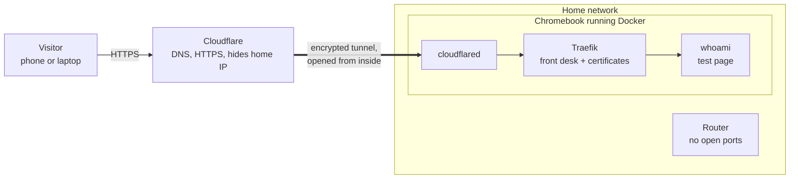
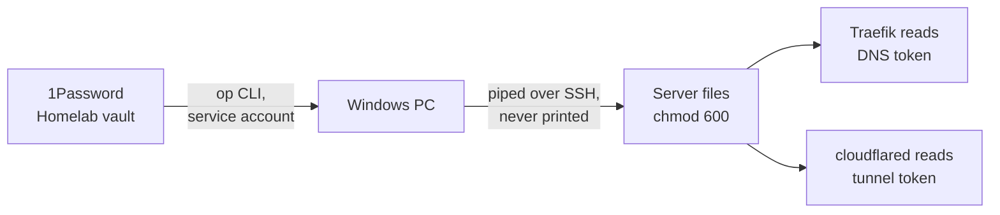
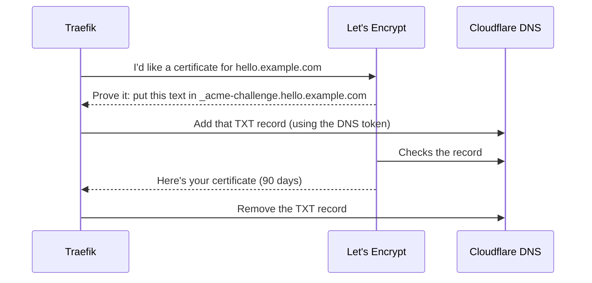

# 2026-11-08: Secrets, a reverse proxy, and a public site with no open ports

**Result:** `https://hello.example.com` loads from anywhere with a valid certificate. The home
router has zero ports forwarded, and the home IP address is never published.

## The big picture



The server dials **out** to Cloudflare and keeps that line open. Visitors' requests ride
back down it, so nothing ever has to get in through the router.

## What I did, in order

1. **Password manager.** Picked 1Password (about $36/yr; Bitwarden is the free option) and
   made a `Homelab` vault. Old logins were copied over by hand so no unencrypted export file
   ever existed on disk.
2. **Cloudflare DNS token.** Created an API token from the "Edit zone DNS" template, limited
   to one zone. Pasted it straight into 1Password. Tested it with a read-only script that
   never prints it ([scripts/test-cloudflare-token.ps1](../scripts/test-cloudflare-token.ps1)).
3. **No more PIN prompts.** The 1Password CLI asks for Windows Hello for every new process,
   and an AI assistant running commands starts a lot of processes. A 1Password **service
   account** that can only see the `Homelab` vault fixed it
   ([howto](../howto/1password-service-account.md)).
4. **Cloudflare security settings.** SSL/TLS mode **Full (strict)**, **Always Use HTTPS**
   on, minimum TLS **1.2**. Left HSTS off for now because it is hard to undo.
5. **Traefik + Let's Encrypt.** Traefik v3 and a `whoami` test app in Docker. Got a
   certificate from Let's Encrypt's **staging** server first, then switched to production
   ([stack](../stacks/proxy/), [howto](../howto/traefik-proxy.md)).
6. **Cloudflare Tunnel.** Created a remotely managed tunnel, ran `cloudflared` as a
   container next to Traefik, and added a public route to `https://traefik:443` with
   **Match SNI to host** on.

## Where secrets live



| Secret | Can do | If it leaks |
|---|---|---|
| Cloudflare DNS token | Edit DNS for one zone | Delete it in Cloudflare, make a new one |
| Cloudflare tunnel token | Run that one tunnel | Rotate it on the tunnel's overview page |
| 1Password service account token | Read/write the Homelab vault only | Revoke it in 1Password's Developer settings |

Containers read tokens from Docker secret files (`CF_DNS_API_TOKEN_FILE`,
`TUNNEL_TOKEN_FILE`), so tokens never appear in `compose.yaml`, `.env` files, or
`docker inspect`.

## How the certificate gets issued (DNS challenge)



Let's Encrypt never connects to the house. Traefik renews about 30 days before expiry.

## Things that tripped me up

| Problem | Fix |
|---|---|
| Copied tunnel token was 32 characters of `eyJhIjoi****…` | The dashboard masks it. Click the eye icon to reveal before copying. A real one is ~180 characters. |
| New environment variable didn't reach the app | Closing the window isn't quitting. Quit from the system tray, then reopen. |
| "The argument … does not exist" running a script | The terminal wasn't in the repo folder. Use the full path. |
| `op run -- …` failed in Windows PowerShell 5.1 | PowerShell swallows a bare `--`. Write `'--'`. |
| Commands sent over SSH broke | The server's login shell is fish. Copy a bash script over and run `bash script.sh`. |
| In-app browser froze on the Cloudflare dashboard | Cloudflare opens pop-ups that block it. Used the regular Chrome browser instead. |
| Would a YubiKey stop the PIN prompts? | No. It's a sign-in second factor, not a Windows Hello unlock. Still worth buying two later. |

## Checks

```powershell
# Through Cloudflare: expect HTTP 200 and "Server: cloudflare"
curl.exe -sS -D - https://hello.example.com -o NUL

# On the LAN, skipping DNS: expect the whoami page and no certificate error
curl.exe -sS --resolve hello.example.com:443:<server-lan-ip> https://hello.example.com
```

## Rollback

- Everything: `docker compose down` in the stack folder. Config, tokens and certs stay on disk.
- Take the site offline only: delete its route in the tunnel's Routes tab (also removes the DNS record).
- Cloudflare settings: the previous values were Full, Always HTTPS off, TLS 1.0.

## Next

- Replace the public `whoami` test page with the real app.
- Reserve the server's IP on the router.
- Later: HSTS, two YubiKeys for account sign-in, uptime monitoring, backups of the stack folder.
